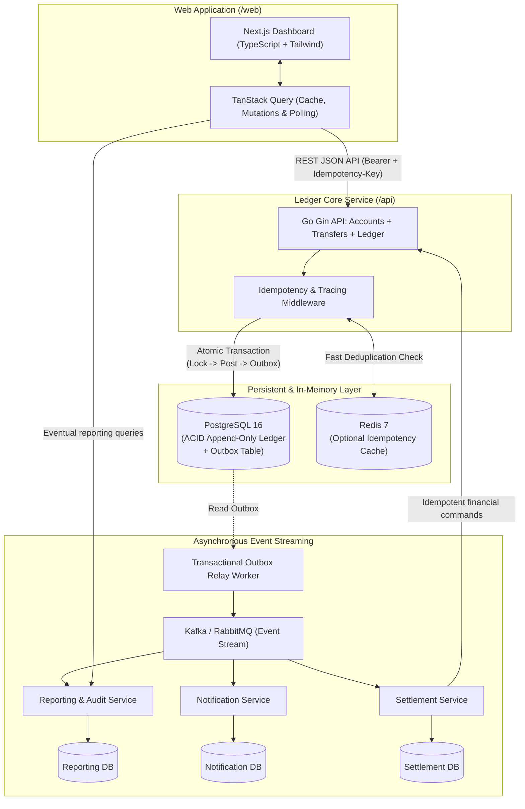

# PayCore: High-Performance Double-Entry Payment & Ledger Engine
> **Targeted for High-Reliability Fintech Engineering (Japan Market & Global Standards)**

---

## 概要 (Japanese Executive Summary)

**PayCore** は、金融グレードのトランザクション整合性を目指す**複式簿記（Double-Entry Bookkeeping）決済・台帳エンジン**の設計仕様です。日本市場を念頭に、信頼性と監査可能性を重視しています。現時点では設計段階であり、本番運用上の保証や法令適合性を示すものではありません。

* **堅牢なトランザクション設計**: 追記型元帳（Append-Only Ledger）、デッドロックを防止する決定論的行ロック（Deterministic Row Locking）、二重引き落としを防ぐ完全冪等性（Strict Idempotency）。
* **最新の分離型アーキテクチャ**:
  * **Backend API (`/api`)**: Go 言語 + **Gin Web Framework** + PostgreSQL + Redis + Kafka/RabbitMQ。
  * **Frontend Web (`/web`)**: **Next.js** + **TypeScript** + **Tailwind CSS** + **TanStack Query** (React Query)。
  * **段階的なマイクロサービス化**: Ledger Core、Reporting & Audit、Notification、Settlement を独立した責務として設計します。Transfer と Ledger は同一サービス・同一トランザクション内に維持します。

---

## 1. System Architecture Overview

PayCore uses a **monorepo with phased microservice extraction**. The target has four business services: **Ledger Core**, **Reporting & Audit**, **Notification**, and **Settlement**. The existing Go API becomes Ledger Core; accounts, transfers, journals, reversals, and posting idempotency remain inside its single ACID transaction boundary. The Next.js dashboard is a separate frontend.

**Current status**: The repository contains a Go/Gin API, a sample-data Next.js dashboard, database-backed email/password login with a one-use image CAPTCHA, and a PostgreSQL connection pool with liveness/readiness endpoints. `run.ps1` starts API/web and, with the default configuration, the isolated local PostgreSQL container. `-ListRoutes` lists registered endpoints without starting servers or requiring a database. Ledger schema/migrations, financial business endpoints, the broker, and extracted services remain planned. See [database setup](docs/database_setup.md). The directory tree below is a target layout. Performance and reliability claims require implementation evidence. Kafka versus RabbitMQ remains an ADR decision; deploy one broker initially.

The service boundaries, data ownership, event contracts, failure handling, and rollout are detailed in [Microservices Architecture (বাংলা)](docs/microservices_architecture_bn.md).



Each service owns its database and migrations; consumers never read or write Ledger Core tables directly. Reporting projections are eventually consistent, while balance checks and authoritative zero-sum audits remain in Ledger Core. Notification and reporting failures must not roll back committed transfers. The outbox relay is a Ledger Core worker, not a separate business service. An optional gateway handles routing and token validation; each service still enforces authorization.

### Repository Directory Structure
```text
PayCore/
├── api/                             # Ledger Core service (existing Go/Gin scaffold)
│   ├── cmd/server/main.go           # Application entrypoint
│   ├── internal/
│   │   ├── handler/                 # Gin HTTP Handlers (REST Controllers)
│   │   ├── middleware/              # Idempotency, CORS, Tracing, Auth
│   │   ├── service/                 # Ledger, Transfer, and Account business logic
│   │   ├── repository/              # PostgreSQL (pgx/sqlc) queries with row locks
│   │   ├── model/                   # Domain entities and DTOs
│   │   └── outbox/                  # Outbox event publisher worker
│   ├── pkg/
│   │   └── money/                   # Precision money types (JPY, USD, zero-decimal handling)
│   ├── Dockerfile
│   └── go.mod
│
├── services/                        # Planned independently deployable services
│   ├── reporting/                   # Reporting & Audit; owns projections and reporting DB
│   ├── notification/                # Notification; owns delivery attempts and preferences
│   └── settlement/                  # Settlement; owns payout workflows and reconciliation
├── contracts/                       # Planned OpenAPI and versioned event schemas
│   ├── openapi/
│   └── events/
├── web/                             # Web Client (Next.js)
│   ├── src/
│   │   ├── components/              # Tailwind UI components (Shadcn-style)
│   │   ├── hooks/                   # Custom TanStack Query hooks (useTransfers, useAccounts)
│   │   ├── lib/                     # Axios/Fetch API client with Idempotency generator
│   │   ├── app/                    # Dashboard, Ledger Explorer, Simulator, Analytics
│   │   └── types/                   # TypeScript interfaces matching Go API models
│   ├── package.json
│   ├── tailwind.config.ts
│   └── tsconfig.json
│
├── docs/                            # Documentation & Architecture Decision Records (ADRs)
│   ├── adr/                         # Architecture Decision Records
│   ├── microservices_architecture_bn.md # Service boundaries, data ownership, rollout
│   └── interview_strategy_bn.md     # Bengali Japan-market interview prep & career guide
├── run.ps1                          # Existing local API + web launcher; selects available ports
├── docker-compose.yml               # Planned infrastructure and service profiles
└── ProjectFeature.md                # System specification & feature roadmap
```

---

## 2. Core Fintech Engineering Features (Backend API - Go + Gin)

### 2.1 Append-Only Double-Entry Ledger Engine
* **Mathematical Zero-Sum Invariant**: Every journal contains at least two positive postings and balances independently in its currency. Cross-currency transfers require separately balanced journals and explicit FX clearing accounts. The fundamental rule is:
  $$\sum \text{Debit} = \sum \text{Credit} \iff \sum \text{Debit} - \sum \text{Credit} = 0$$
* **Never Update Balance Directly**: Direct updates (`UPDATE accounts SET balance = balance + X`) are strictly prohibited. Balances are derived aggregations calculated from append-only ledger entries or verified materialized balance snapshots.
* **Audit-Safe Reversals**: Mistakes or chargebacks cannot delete or mutate historic rows. They must be resolved via **compensating reversal entries** referencing the original `journal_entry_id`.
* **Zero-Decimal & Multi-Currency Support (ISO 4217)**:
  * Native handling of zero-decimal currencies like **Japanese Yen (JPY)** where $1 \text{ JPY} = \text{base integer unit}$ (no cents/fractions).
  * Store and transfer amounts as integer minor units with explicit currency scales (JPY: 0, USD/EUR: 2). Validate positivity, supported currencies, and `int64` bounds; use checked or arbitrary-precision arithmetic for totals. JSON amounts are decimal strings to preserve exact values in JavaScript. Never use binary floating point for money.

### 2.2 Strict Multi-Tier Idempotency Model
* **The Problem**: Network timeouts, retries, and mobile client disconnects frequently cause duplicate transfer requests.
* **Two-Tier Defense**:
  1. **Tier 1 (Optional Redis Cache)**: Cache completed responses under the authenticated `(client_id, key)` scope, including a request hash. Redis is an optimization; cache misses, outages, or TTL expiry must fall through to PostgreSQL and never authorize a second execution.
  2. **Tier 2 (PostgreSQL Atomic Invariant)**: The `idempotency_records` primary key is `(client_id, key)`. Claim the key inside the same ACID transaction as the journal, postings, outbox event, and final response. Concurrent inserts serialize through the unique constraint. After completion, a matching retry returns the stored status and response without re-executing postings; a different request hash returns `422 Unprocessable Entity`. Hash the HTTP method, normalized route (including target IDs), and canonical validated body. Derive `client_id` from authentication, never from the request body. Retain records for the supported retry lifetime; deleting them permits key reuse and requires an explicit retention policy.
* **In-Flight Requests**: A duplicate may wait for the first transaction, or receive `409 Conflict` with `Retry-After` if the bounded wait expires. Retrying the same key after completion returns the saved result. Rollback removes the claim along with all financial effects.

### 2.3 Deterministic Concurrency Control
* **Deterministic Lock Ordering**: When transferring between Account A and Account B concurrently with a transfer from B to A, naive `SELECT FOR UPDATE` causes PostgreSQL deadlocks (`40P01`).
* **Implementation**: Accounts are sorted by ID ascending before acquiring row-level locks:
  ```sql
  -- Always lock in deterministic order: min(from_id, to_id) first, then max(from_id, to_id)
  SELECT id, currency, is_active FROM accounts 
  WHERE id IN ($1, $2) 
  ORDER BY id ASC 
  FOR UPDATE;
  ```
* Lock every affected account in this order, including fee and reversal accounts, and verify all requested accounts exist, are active, are authorized, and match the journal currency. After acquiring locks, read committed postings in a new statement at `READ COMMITTED` isolation and enforce account-specific overdraft rules before inserting postings. Every posting path must use this protocol to prevent concurrent overspending.
* Consistent account ordering reduces deadlocks; it does not eliminate every possible database deadlock. Use bounded whole-transaction retries for `40P01` and `40001`, preserving the idempotency key.

### 2.4 Transactional Outbox Pattern (Dual-Write Prevention)
* To guarantee audit logging and message publishing to **Kafka / RabbitMQ** without dual-write failures (e.g., DB commits, but broker crashes):
  * The ledger entries and an `outbox_events` record are saved inside the **exact same PostgreSQL transaction**.
  * A background Go worker reads unpublished outbox rows using `SELECT ... FOR UPDATE SKIP LOCKED`, pushes them to Kafka, and marks them `PUBLISHED`.
  * Mark rows published only after broker acknowledgment. A crash after publishing but before committing that marker can cause duplicate delivery: this is **at-least-once delivery**. Consumers must deduplicate by the stable outbox event ID in the same transaction as their side effects. Use bounded backoff, retry scheduling, and an operator-visible failed-event replay path.

---

## 3. Web Dashboard Features (`/web` - Next.js + TypeScript + Tailwind + TanStack Query)

The frontend provides an interactive, institutional-grade administrative console designed for risk teams, auditors, and engineering demonstrations.

### 3.1 Real-Time Financial Health & Zero-Sum Verifier
* **Invariant Audit Widget**: Checks each journal and the system-wide debit/credit difference per currency using a consistent database snapshot, displaying a zero-sum badge (`STATUS: BALANCED (Δ = 0 JPY)`). A trial balance includes all five account types; assets and liabilities alone need not match. Display the last successful audit time and flag stale or failed checks.
* **Automated Polling**: Utilizes TanStack Query's `refetchInterval` to maintain up-to-the-second ledger synchronization.

### 3.2 Visual Double-Entry Transfer Studio
* **Interactive Transaction Builder**: Allows operators to construct multi-leg journal entries (e.g., Transfer + Platform Fee + Withholding Tax).
* **Live Balance Validation**: The UI disables the "Execute Transfer" button until `Total Debits == Total Credits`.
* **UUID Idempotency Generator**: Automatically generates and displays the active `Idempotency-Key` with an option to replay or tamper for testing.

### 3.3 Transaction Ledger & Audit Explorer
* **Timeline View**: Visual audit trail showing original transactions linked with their compensatory reversal entries.
* **Account Drill-down**: Click on any account (Asset, Liability, Equity, Revenue, Expense) to see chronological postings with computed running balances.
* **Filtered Searches**: Query by Account ID, Currency (JPY/USD), Date range, and Transaction Type.

### 3.4 Idempotency & Fault Injection Simulator (Demo Mode)
* Specially built for technical interview demonstrations:
  * **"Spam Duplicate Request" Button**: Fires 5 parallel asynchronous requests with the identical `Idempotency-Key` to demonstrate that only 1 transfer is committed. Requests that exceed the in-flight wait receive `409` and retry the same key; completed replays receive the identical stored successful response.
  * **"Tampered Payload" Test**: Sends the same key with altered amounts to show immediate `422 Unprocessable Entity` rejection.

### 3.5 Frontend Tech Stack Details
* **Next.js**: App Router frontend with development HMR and production builds.
* **TypeScript**: Strict typing across all DTOs and API contracts shared with the backend.
* **Tailwind CSS**: Clean, responsive, high-contrast fintech design palette (Slate/Zinc, Emerald for credit, Rose for debit).
* **TanStack Query (React Query v5)**:
  * Query caching and automated cache invalidation upon transfer mutations (`queryClient.invalidateQueries({ queryKey: ['accounts'] })`).
  * Show pending transfers immediately, but display confirmed balances only after server acknowledgment and query invalidation. Preserve the same idempotency key across retries of one logical transfer.

---

## 4. Database Schema (PostgreSQL DDL)

This is the **Ledger Core database** baseline, not a complete migration or a shared schema for all services. Reporting, Notification, and Settlement own separate databases and migrations; external IDs are references, not cross-database foreign keys. Before accepting writes, add deferred constraint triggers that validate at least two postings and equal debit/credit totals per journal at commit, and enforce posting-account currency equality. Deny `UPDATE`/`DELETE` on journals and postings to the application role, prevent later inserts into committed journals, and restrict writes to a controlled posting function that follows the locking protocol. Row-level `CHECK` constraints alone cannot enforce a cross-row zero-sum invariant. Derive reversal status from the linked reversal journal instead of mutating historical headers.

```sql
-- 1. Accounts Table (Chart of Accounts)
CREATE TYPE account_type AS ENUM ('ASSET', 'LIABILITY', 'EQUITY', 'REVENUE', 'EXPENSE');

CREATE TABLE accounts (
    id UUID PRIMARY KEY DEFAULT gen_random_uuid(),
    account_number VARCHAR(64) UNIQUE NOT NULL,
    name VARCHAR(255) NOT NULL,
    type account_type NOT NULL,
    currency VARCHAR(3) NOT NULL DEFAULT 'JPY' CHECK (currency IN ('JPY', 'USD', 'EUR')),
    is_active BOOLEAN NOT NULL DEFAULT TRUE,
    created_at TIMESTAMPTZ NOT NULL DEFAULT NOW(),
    updated_at TIMESTAMPTZ NOT NULL DEFAULT NOW()
);

-- 2. Journal Entries (The Transaction Header)
CREATE TABLE journal_entries (
    id UUID PRIMARY KEY DEFAULT gen_random_uuid(),
    reference_id VARCHAR(128) NOT NULL, -- e.g., ORDER_12345
    description TEXT NOT NULL,
    posted_at TIMESTAMPTZ NOT NULL DEFAULT NOW(),
    currency VARCHAR(3) NOT NULL CHECK (currency IN ('JPY', 'USD', 'EUR')),
    reversal_for_id UUID UNIQUE REFERENCES journal_entries(id) ON DELETE RESTRICT,
    CHECK (reversal_for_id IS NULL OR reversal_for_id <> id)
);

-- 3. Ledger Postings (Append-Only Individual Debits & Credits)
CREATE TABLE ledger_postings (
    id UUID PRIMARY KEY DEFAULT gen_random_uuid(),
    journal_entry_id UUID NOT NULL REFERENCES journal_entries(id) ON DELETE RESTRICT,
    account_id UUID NOT NULL REFERENCES accounts(id) ON DELETE RESTRICT,
    amount BIGINT NOT NULL CHECK (amount > 0), -- Integer minor units (1000 JPY or 1000 cents)
    direction VARCHAR(6) NOT NULL CHECK (direction IN ('DEBIT', 'CREDIT')),
    created_at TIMESTAMPTZ NOT NULL DEFAULT NOW()
);
CREATE INDEX idx_postings_account_created ON ledger_postings(account_id, created_at DESC);

-- 4. Idempotency Records
CREATE TABLE idempotency_records (
    key VARCHAR(255) NOT NULL,
    client_id VARCHAR(128) NOT NULL,
    request_hash VARCHAR(64) NOT NULL,
    status_code INT CHECK (status_code BETWEEN 100 AND 599),
    response_body JSONB,
    created_at TIMESTAMPTZ NOT NULL DEFAULT NOW(),
    PRIMARY KEY (client_id, key),
    CHECK ((status_code IS NULL) = (response_body IS NULL))
);

-- 5. Transactional Outbox (polling relay for Kafka / RabbitMQ)
CREATE TABLE outbox_events (
    id UUID PRIMARY KEY DEFAULT gen_random_uuid(),
    aggregate_type VARCHAR(64) NOT NULL DEFAULT 'TRANSFER',
    aggregate_id VARCHAR(128) NOT NULL,
    event_type VARCHAR(64) NOT NULL,
    payload JSONB NOT NULL,
    status VARCHAR(20) NOT NULL DEFAULT 'PENDING' CHECK (status IN ('PENDING', 'PUBLISHED', 'FAILED')),
    retry_count INT NOT NULL DEFAULT 0,
    created_at TIMESTAMPTZ NOT NULL DEFAULT NOW(),
    published_at TIMESTAMPTZ
);
CREATE INDEX idx_outbox_pending ON outbox_events(status, created_at) WHERE status = 'PENDING';
```

Idempotency response fields may be null while the transaction owns the new claim. The posting function must fill both fields before commit; add a deferred constraint trigger that rejects committed incomplete records. A full reversal must copy every original posting with its direction flipped, preserve currency and amounts, and lock the original journal before checking eligibility. The unique `reversal_for_id` permits at most one full reversal per original journal; partial reversals are outside this initial scope.

---

## 5. Gin Web API Specification (`/api/v1`)

These are **planned Ledger Core endpoints**, not currently implemented routes. The current `GET /` returns service information and indicates HTTP reachability only; it does not prove database or broker readiness. Reporting queries, notification delivery controls, and settlement workflows belong to their respective services; their proposed route prefixes are documented in the service architecture guide.

All endpoints require authentication and account-level authorization. Audit, outbox metrics, and fault-injection controls require operator privileges; fault injection is available only in an isolated demo environment. Validate journal balance on the server regardless of frontend validation. Missing idempotency keys return `400`; reused keys with changed requests return `422`; in-flight wait expiry returns `409` with `Retry-After`.

| Method | Endpoint | Description | Key Headers / Parameters |
| :--- | :--- | :--- | :--- |
| `POST` | `/api/v1/accounts` | Create ledger account | `Authorization: Bearer <token>` |
| `GET` | `/api/v1/accounts/:id` | Fetch account & derived balance | Path: `id` |
| `GET` | `/api/v1/accounts/:id/postings`| Paginated ledger postings | Query: `limit`, `cursor` |
| `POST` | `/api/v1/transfers` | Execute double-entry transfer | **`Idempotency-Key: <UUID>`** (Required) |
| `POST` | `/api/v1/transfers/:id/reverse`| Issue compensating reversal | `Idempotency-Key`, Path: `id` |
| `GET` | `/api/v1/audit/zero-sum` | Run full system balance audit | Query: `currency=JPY` |
| `GET` | `/api/v1/outbox/metrics` | Outbox lag & event stream health| - |

### Sample Transfer Payload (`POST /api/v1/transfers`)
```json
{
  "reference_id": "TXN_20261115_0098",
  "description": "Peer-to-peer wallet transfer",
  "currency": "JPY",
  "legs": [
    {
      "account_id": "d3b07384-d113-4665-b778-f076efef1111",
      "direction": "DEBIT",
      "amount": 50000
    },
    {
      "account_id": "a9c04291-8842-4f76-bc34-e123afab2222",
      "direction": "CREDIT",
      "amount": 50000
    }
  ]
}
```

---

## 6. Implementation & Portfolio Roadmap

- [x] **Milestone 1**: System Architecture & Financial Model Design (Current)
- [ ] **Milestone 2**: Core Go Engine with Gin (`/api`)
  - [ ] Implement Gin middleware (Idempotency, Request Tracing, Recovery).
  - [ ] Implement deterministic lock ordering repository with PostgreSQL.
  - [ ] Implement Transactional Outbox worker with Kafka/RabbitMQ driver.
  - [ ] Write table-driven unit tests proving $\sum \text{Debit} - \sum \text{Credit} = 0$.
- [ ] **Milestone 3**: Web Frontend (`/web`)
  - [x] Bootstrap Next.js app with TypeScript and Tailwind CSS (scaffold only).
  - [ ] Configure TanStack Query client and custom mutation hooks.
  - [ ] Build Double-Entry Transfer Studio and Idempotency Replay Tester.
  - [ ] Implement Real-Time Zero-Sum Verification status bar.
- [ ] **Milestone 4**: Docker Compose & Live Demonstration Suite
  - [ ] Containerize API (`golang:alpine`) and Web (`node:alpine` / static Nginx).
  - [ ] Automated seed script with realistic Japanese banking accounts (JPY).
  - [ ] Concurrency load testing suite using `k6` or `wrk` measuring deadlocks, bounded retries, throughput, and latency; verify no duplicate postings or overdrafts.
  - [ ] PostgreSQL integration tests for unbalanced journal rejection, append-only enforcement, currency validation, and simultaneous full reversals.
  - [ ] Retry and failure tests covering concurrent duplicates, changed payloads, Redis outages, rollback, and crashes between broker acknowledgment and the outbox marker commit.

- [ ] **Milestone 5**: Extract Reporting & Audit and Notification
  - [ ] Define versioned event envelopes, OpenAPI contracts, and independent database credentials/migrations.
  - [ ] Publish `ledger.journal_posted.v1` and `ledger.journal_reversed.v1` through the Core outbox.
  - [ ] Build Reporting projections with per-consumer inbox deduplication, replay, lag metrics, and visible freshness.
  - [ ] Build Notification delivery with stable delivery IDs, bounded retries, and failed-message replay.
  - [ ] Add independent service images, readiness checks, and optional Compose profiles; keep the default `run.ps1` API + web workflow.
  - [ ] Verify transfers still commit while consumers or the broker are unavailable, with eventual event recovery and monitored outbox capacity.
- [ ] **Milestone 6**: Settlement Service (sandbox first)
  - [ ] Define reserve/capture/release commands and clearing accounts in Ledger Core before implementing payouts.
  - [ ] Build payout workflow, provider idempotency, callback inbox, and reconciliation against sandbox statements.
  - [ ] Verify duplicate/out-of-order callbacks, ambiguous provider timeouts, and compensation without distributed database transactions.
