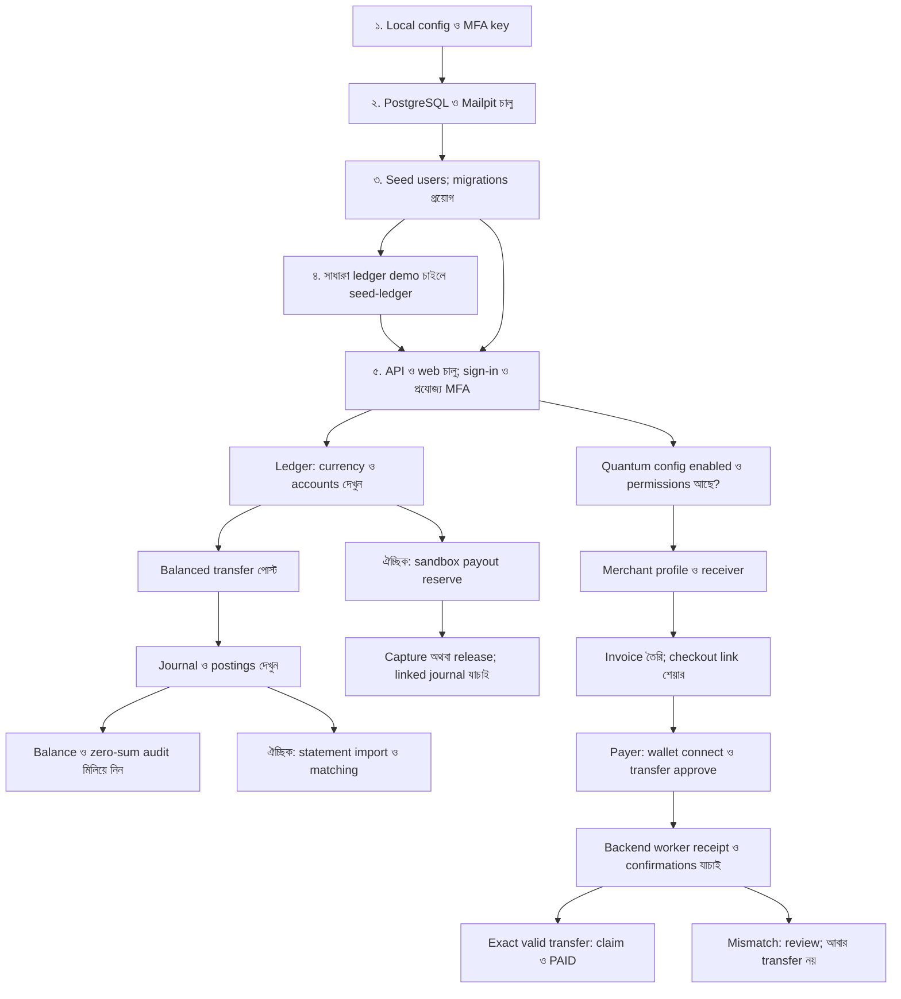
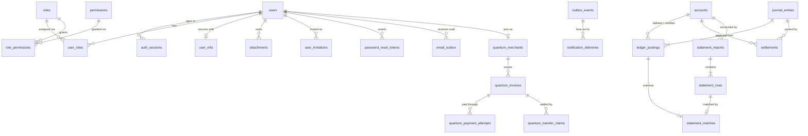
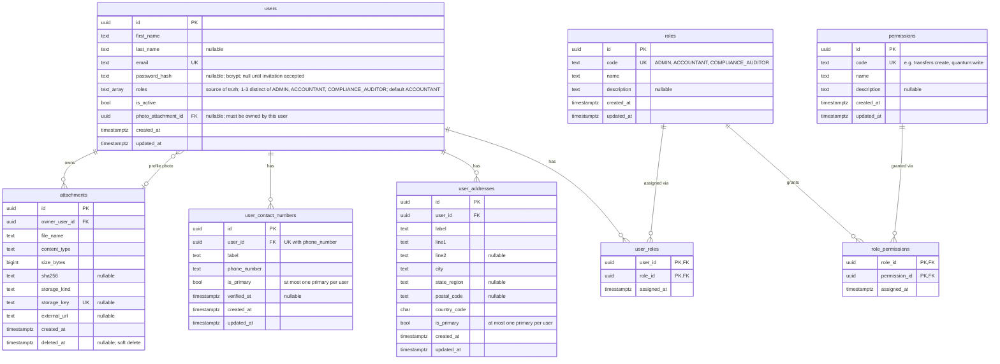
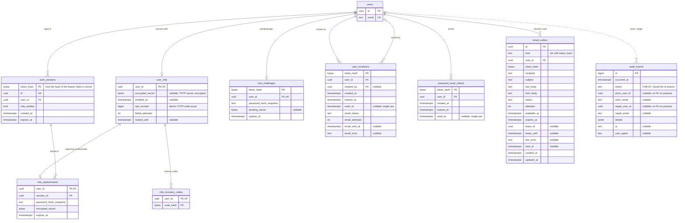
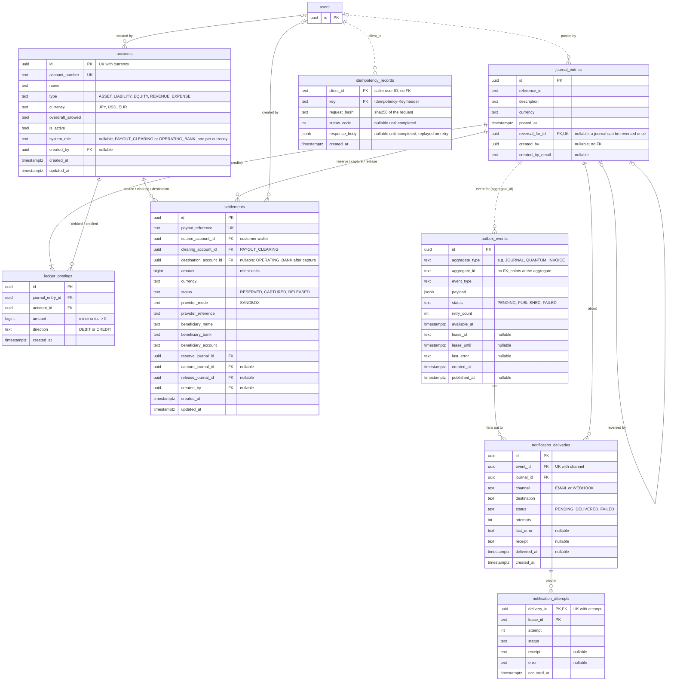
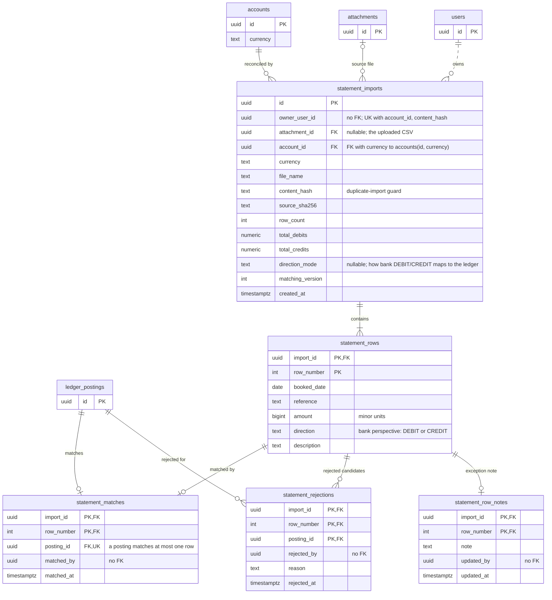
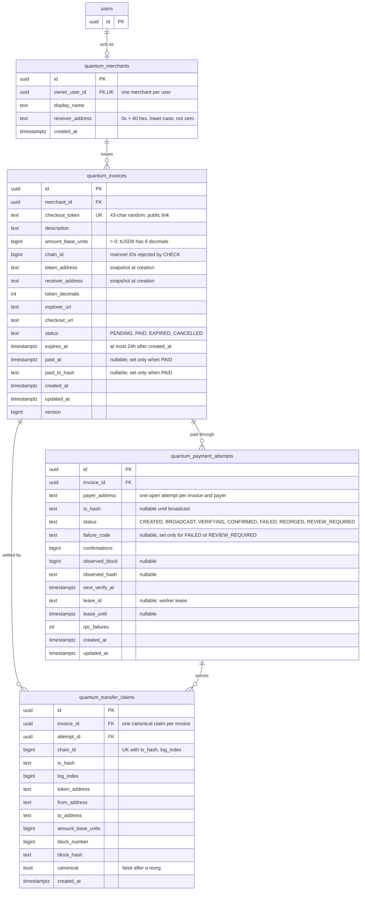

# Database ERD (Entity Relationship Diagram)

PayCore-এর PostgreSQL schema-র ছবি: কোন table-এ কী থাকে, আর table-গুলো কীভাবে একে অপরের সাথে যুক্ত। Diagram-গুলো **migration 026 পর্যন্ত** চালানো dev database থেকে নেওয়া হয়েছে (columns, foreign keys, unique keys, 2026-11-22)। Migration 026 কোনো table বা column বদলায়নি; শুধু role-এর তালিকা আর `users.roles`-এর নিয়ম বদলেছে ([নিচে দেখুন](#২-identity--access-user-role-permission))।

> Schema বদলানোর একমাত্র উপায় নতুন migration ([api/database/migrations/](../api/database/migrations/))। Migration যোগ করলে এই পেজও আপডেট করুন।

## App ব্যবহার করতে কোনটার পরে কী

**ERD-র রেখা table-এর সম্পর্ক বোঝায়; এগুলো command চালানোর ক্রম নয়।** Table নিজে বানানো বা row হাতে insert করা দিয়ে app ব্যবহার শুরু করবেন না। Migrations schema তৈরি করে; UI ও service প্রতিটি workflow-এর data লেখে। Command-সহ walkthrough আছে [User guide-এর setup checklist](user_guide.md#প্রথমবারের-setup-checklist)-এ।

Ledger এবং Quantum **আলাদা পথ**। Ledger demo চালাতে wallet লাগে না; Quantum merchant setup করতে sample JPY ledger লাগে না। Smart contract deployment বা agent mandate এই বর্তমান direct-token checkout-এর prerequisite নয়; সেগুলোর deployment ও app integration আলাদা কাজ।

### User action থেকে database record

| আগে কী লাগবে | App-এ কী করবেন | যে data তৈরি বা ব্যবহার হবে | সফলতা কীভাবে দেখবেন | এরপর |
| --- | --- | --- | --- | --- |
| Migrations ও sample users | Email/password/CAPTCHA, প্রযোজ্য MFA দিয়ে sign-in | `users`, `roles`, `role_permissions`; `user_mfa`/challenges প্রযোজ্য হলে; শেষে `auth_sessions` | Overview ও role অনুযায়ী sidebar | Accounts অথবা Quantum |
| Sign-in, সঠিক permission | Team member invite | `users` → `user_invitations` ও `email_outbox`; admin action `audit_events`-এ | Email link ব্যবহার করে teammate নিজের password সেট করেন | Teammate sign-in |
| একই currency-র funded accounts | Balanced transfer submit | `idempotency_records`, `journal_entries`, `ledger_postings`, `outbox_events` এক transaction-এ | Posted journal; Accounts balance পরিবর্তন | Ledger explorer → Invariant audit |
| Original journal ও reverse permission | Transfer reverse | নতুন `journal_entries` ও বিপরীত `ledger_postings`; original-এর সঙ্গে reference | Original history থাকে, reversal journal আলাদা | Balance ও audit আবার যাচাই |
| Funded wallet, clearing ও bank system-role accounts | Sandbox reserve → capture অথবা release | `settlements`, প্রতিটি ধাপের journal/postings ও outbox | `RESERVED` → `CAPTURED` অথবা `RELEASED` | Linked journal যাচাই |
| Account ও আগের ledger posting | CSV preview → import → matching configure → confirm | `statement_imports` → `statement_rows` → `statement_matches`; প্রয়োজনে rejection/note | Row `MATCHED`; balance অপরিবর্তিত | Unmatched/ambiguous row review |
| Committed ledger/settlement event | Delivery Center ও Event outbox দেখুন | `outbox_events` → `notification_deliveries` → `notification_attempts` | Sandbox receipt/attempt status | Failure হলে অনুমতি অনুযায়ী retry/replay |
| Quantum enabled, signed-in merchant | Merchant profile save | `users` → `quantum_merchants` | Display name ও receiver দেখায় | Invoice তৈরি |
| Merchant profile | New invoice | `quantum_invoices`, invoice-creation idempotency record | `PENDING` ও checkout link | Payer-কে link দিন |
| Payable invoice ও testnet wallet | Pay → wallet approve → hash submit | `quantum_payment_attempts`: `CREATED` → `BROADCAST`/`VERIFYING` | Attempt, hash ও confirmations; এখনও paid নয় | Worker verification-এর অপেক্ষা |
| Exact transfer ও যথেষ্ট confirmations | Worker finalizes; user status দেখেন | Unique `quantum_transfer_claims`, confirmed attempt, `PAID` invoice ও reserved outbox event এক transaction-এ | Checkout ও merchant detail-এ `PAID` | Explorer/hash মিলিয়ে নিন |

একই transaction-এর row-গুলো **একসঙ্গে commit** হয়। Table-এর তালিকা দেখে journal আগে commit করে postings পরে লেখার মতো আলাদা operation করবেন না। Checkout hash জমা দেওয়া এবং final verification অবশ্য আলাদা ধাপ; প্রথমটি `202` ফিরিয়ে দেয়, দ্বিতীয়টি worker চালায়। Quantum events থেকে বর্তমান ledger posting বা merchant webhook delivery হয় না।

### State দেখে পরের কাজ

| State/ফল | পরের কাজ |
| --- | --- |
| Transfer posted | Journal, balances ও zero-sum audit দেখুন |
| Settlement `RESERVED` | Capture অথবা release, একই payout-এ দুটো নয় |
| Statement `SUGGESTED`/`AMBIGUOUS` | Candidate মিলিয়ে confirm; ভুল candidate reject/note করুন |
| Invoice `PENDING` | মেয়াদ থাকলে payer checkout ব্যবহার করতে পারেন |
| Attempt `BROADCAST`/`VERIFYING` | Confirmations-এর অপেক্ষা; hash alone সফলতার প্রমাণ নয় |
| Invoice `PAID` | Paid hash ও explorer মিলিয়ে নিন |
| Attempt `REVIEW_REQUIRED`, অথবা broadcast-এর পরে API error | নতুন transfer নয়; hash নিয়ে merchant-এর সঙ্গে review করুন |
| Invoice `EXPIRED`/`CANCELLED` | নতুন payment শুরু করবেন না; merchant-এর কাছে নতুন invoice চান |
| Attempt `REORGED` | আগের confirmation আর নির্ভরযোগ্য নয়; claim noncanonical হতে পারে, invoice আবার pending/expired দেখাতে পারে। নতুন transfer না পাঠিয়ে merchant review ও worker reconciliation-এর অপেক্ষা করুন |

## কীভাবে পড়বেন (How to read)

- **৩৫টা table**, domain অনুযায়ী ৬ ভাগে ভাগ করা। প্রথমে overview, তারপর প্রতিটা domain-এর বিস্তারিত (সব column সহ)।
- `PK` = primary key, `FK` = foreign key, `UK` = unique। Comment-এ `nullable` মানে column-টা `NULL` হতে পারে; বাকি সব `NOT NULL`।
- **নিরেট রেখা (solid line)** = database-এ আসল foreign key আছে।
- **ডটেড রেখা (dotted line, `..`)** = শুধু logical reference, কোনো FK নেই। বেশিরভাগ ক্ষেত্রে এটা ইচ্ছাকৃত, যেমন audit log user delete হওয়ার পরেও টিকে থাকে।
- Cardinality: `||` = ঠিক একটা, `o|` = শূন্য বা একটা, `o{` = শূন্য বা অনেক, `|{` = এক বা অনেক।
- Type: `timestamptz` = `timestamp with time zone`; টাকা সবসময় `bigint` (minor unit), কখনো float নয়।

GitHub আর VS Code (Mermaid extension) এই diagram সরাসরি render করে।

## ১. Overview: সব domain এক নজরে

| Domain | Tables | কাজ |
| --- | --- | --- |
| [Identity & access](#২-identity--access-user-role-permission) | `users`, `roles`, `permissions`, `user_roles`, `role_permissions`, `user_addresses`, `user_contact_numbers`, `attachments` | কে, কোন role, কী permission; profile আর file |
| [Auth security](#৩-auth-security-session-mfa-invitation-email) | `auth_sessions`, `user_mfa`, `mfa_challenges`, `mfa_recovery_codes`, `mfa_replacements`, `user_invitations`, `password_reset_tokens`, `email_outbox`, `audit_events` | Session, two-factor, invitation/reset link, email delivery, audit trail |
| [Ledger & settlement](#৪-ledger-settlement-outbox) | `accounts`, `journal_entries`, `ledger_postings`, `idempotency_records`, `settlements`, `outbox_events`, `notification_deliveries`, `notification_attempts` | Double-entry হিসাব, idempotency, payout, event delivery |
| [Reconciliation](#৫-reconciliation-bank-statement) | `statement_imports`, `statement_rows`, `statement_matches`, `statement_rejections`, `statement_row_notes` | Bank statement import করে ledger-এর সাথে মেলানো |
| [Quantum](#৬-paycore-quantum-testnet-checkout) | `quantum_merchants`, `quantum_invoices`, `quantum_payment_attempts`, `quantum_transfer_claims` | Testnet tUSD8 invoice আর on-chain পেমেন্ট যাচাই |
| System | `schema_migrations` | কোন migration চলেছে (`version`, `applied_at`); অন্য কোনো table-এর সাথে যুক্ত নয় |

## ২. Identity & access (user, role, permission)

- একজন user-এর effective role আসে `users.roles` থেকে। `user_roles` হলো তার mirror; mirror পুরনো হলেও কেউ বাড়তি role পায় না ([rbac.md](rbac.md))।
- **Role এখন ৩টা** (migration [026_accountant_roles.sql](../api/database/migrations/026_accountant_roles.sql)): `ADMIN`, `ACCOUNTANT`, `COMPLIANCE_AUDITOR`। পুরনো role-গুলো মুছে ফেলা হয়েছে, আর তাদের permission নতুন role-এ চলে গেছে:

  | পুরনো role | এখন | Permission |
  | --- | --- | --- |
  | `OPERATOR` | `ACCOUNTANT` | OPERATOR-এর সব grant ACCOUNTANT-এ কপি হয়েছে |
  | `LEAD_OPERATOR` | Explicit review | Pending 026-এর আগে উপযুক্ত role বেছে নিতে হবে; স্বয়ংক্রিয় ADMIN promotion runner আটকায় |
  | `STAFF_ENGINEER` | Explicit review | Pending 026-এর আগে উপযুক্ত role বেছে নিতে হবে; স্বয়ংক্রিয় ADMIN promotion runner আটকায় |

  026 ইতিমধ্যে applied হলে আগের SQL mapping-এর ADMIN assignment অপরিবর্তিত থাকে। সেগুলো review করতে deployment history লাগবে; runner অনুমান করে demote করে না। দেখুন [legacy upgrade review](rbac.md#legacy-role-upgrade-review)।

- `users.roles`-এ `CHECK (valid_user_roles(roles))`: ১ থেকে ৩টা role, কোনো duplicate বা `NULL` নয়, আর শুধু ওই ৩টার মধ্য থেকে। নতুন user-এর ডিফল্ট role `ACCOUNTANT`।
- Profile photo-র FK composite: `(photo_attachment_id, id)` → `attachments(id, owner_user_id)`। তাই অন্যের file কেউ নিজের photo বানাতে পারে না।

## ৩. Auth security (session, MFA, invitation, email)

- Token (session, invitation, reset, MFA challenge) কখনো সরাসরি রাখা হয় না, শুধু তার **hash** থাকে। Database চুরি হলেও token কাজে লাগবে না।
- `audit_events` **append-only**: database নিজেই update আর delete আটকায়। User delete হওয়ার পরেও ইতিহাস রাখার জন্য এখানে ইচ্ছা করে FK নেই; email-টাও কপি করে রাখা হয়।

## ৪. Ledger, settlement, outbox

- **Balance কোথাও সংরক্ষিত নেই।** Account-এর balance সবসময় তার `ledger_postings` যোগ করে বের করা হয়, তাই balance আর history কখনো আলাদা হতে পারে না।
- `journal_entries` আর `ledger_postings` **append-only**: database unbalanced journal, edit, delete আর দেরিতে আসা posting প্রত্যাখ্যান করে ([ledger.md](ledger.md))।
- একটা settlement তিনটা account আর সর্বোচ্চ তিনটা journal-এর সাথে যুক্ত: reserve (source → clearing), তারপর capture (clearing → bank) অথবা release (clearing → source)।
- টাকা সরানোর প্রতিটা write একই transaction-এ একটা `outbox_events` row লেখে (transactional outbox)। Relay সেটা পরে deliver করে।

## ৫. Reconciliation (bank statement)

- Statement import **টাকা সরায় না**। এটা শুধু bank-এর row রাখে আর `ledger_postings`-এর সাথে মেলায় ([reconciliation.md](reconciliation.md))।
- `(account_id, currency)` → `accounts(id, currency)` composite FK নিশ্চিত করে যে statement-এর currency account-এর currency-র সাথে মেলে।
- Row-এর key `(import_id, row_number)`; match, rejection আর note সবাই এই composite key দিয়ে row-এর সাথে যুক্ত।

## ৬. PayCore Quantum (testnet checkout)

- **একই on-chain transfer দুইবার কাজে লাগানো যায় না।** `(chain_id, tx_hash, log_index)` unique, তাই একটা transfer event দিয়ে দুটো invoice শোধ হয় না।
- **একটা invoice-এ একসঙ্গে মাত্র একটা canonical payment থাকে।** Partial unique index `quantum_one_canonical_payment` এটি রক্ষা করে। Reorg-এ claim noncanonical হতে পারে; একই payment পরে canonical হলে invoice reconfirm হতে পারে।
- Invoice তৈরির সময় token, receiver, chain আর decimals **snapshot** করে রাখা হয়। পরে config বদলালেও পুরনো invoice-এর শর্ত বদলায় না।
- Quantum module **accounting ledger থেকে আলাদা**: এখানে কোনো `ledger_postings` লেখা হয় না। শুধু `quantum.invoice.paid` আর `quantum.invoice.reorged` event `outbox_events`-এ যায় ([quantum/ARCHITECTURE.md](quantum/ARCHITECTURE.md))।

## Database-level guarantees (সারাংশ)

| Guarantee | কোথায় প্রয়োগ হয় |
| --- | --- |
| Email unique | `users.email` UK |
| Journal balanced, immutable | `journal_entries`, `ledger_postings` triggers ([014_ledger_core.sql](../api/database/migrations/014_ledger_core.sql)) |
| একটা journal একবারই reverse হয় | `journal_entries.reversal_for_id` UK |
| Retry-তে double posting হয় না | `idempotency_records` PK `(client_id, key)` |
| প্রতি currency-তে একটা clearing আর একটা bank account | `accounts_currency_system_role_key` partial unique index |
| Audit log বদলানো যায় না | `audit_events` triggers |
| Statement দুইবার import হয় না | `statement_imports` UK `(owner_user_id, account_id, content_hash)` |
| একটা posting একটাই statement row-এর সাথে মেলে | `statement_matches.posting_id` UK |
| একটা on-chain transfer একটাই invoice শোধ করে | `quantum_transfer_claims` UK `(chain_id, tx_hash, log_index)` |
| প্রতি invoice-এ একটাই বৈধ পেমেন্ট | `quantum_one_canonical_payment` partial unique index |
