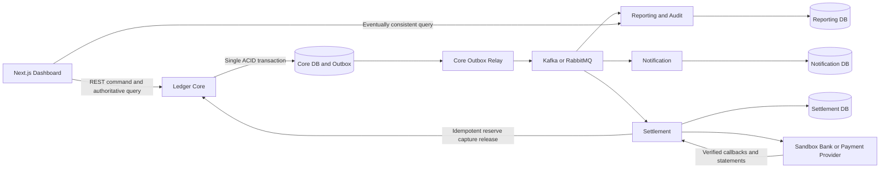

# PayCore: Microservices Architecture

PayCore-এর লক্ষ্য হলো **চারটি business microservice**। বর্তমানে `api/`-তে Go/Gin scaffold এবং `web/`-তে Next.js scaffold আছে; নিচের service ও financial workflow-গুলো এখনো বাস্তবায়িত হয়নি। প্রথমে Ledger Core সম্পূর্ণ হবে, তারপর পর্যায়ক্রমে অন্য service আলাদা deploy করা হবে। একই monorepo-তে থেকেও প্রতিটি service-এর নিজস্ব build, configuration, database credentials ও deployment থাকবে।

## ১. কোন অংশ কোন service হবে

| Service | দায়িত্ব | নিজের data | যোগাযোগ ও rollout |
| --- | --- | --- | --- |
| **Ledger Core** (`api/`) | Ledger account, transfer, posting, balance validation, reversal, authoritative zero-sum audit, financial idempotency | `accounts`, `journal_entries`, `ledger_postings`, `idempotency_records`, `outbox_events`; পরে reservation records | প্রথম ধাপ; synchronous REST command/query, outbox থেকে committed event |
| **Reporting & Audit** (`services/reporting/`) | Dashboard analytics, search projection, statement/export, financial event timeline | Reporting projections, consumed event inbox, export jobs, replay checkpoints | দ্বিতীয় ধাপ; Core events consume করবে, REST দিয়ে reports দেবে |
| **Notification** (`services/notification/`) | Transfer/settlement notification, email/webhook delivery, delivery retry | Preferences, subscriptions, templates, delivery attempts, event inbox/outbox | দ্বিতীয় ধাপ; events consume করবে, external provider-এ delivery করবে |
| **Settlement** (`services/settlement/`) | Bank/provider payout workflow, settlement batch, callback processing, statement reconciliation | Payout requests, workflow state, provider references, reconciliation results, inbox/outbox | তৃতীয় ধাপ; sandbox adapter দিয়ে শুরু, Core-এ authenticated idempotent command পাঠাবে |

Reporting-এর event timeline একটি derived view। মূল journal ও posting-ই authoritative financial record। Login, account-status change বা administrator action-এর security audit প্রয়োজন হলে সংশ্লিষ্ট owner service নিজস্ব durable audit/outbox record লিখবে; শুধু financial event timeline দিয়ে সেই audit সম্পূর্ণ হবে না।

## ২. যে অংশগুলো একসঙ্গে থাকবে

**Account + Transfer + Ledger + Reversal একই Ledger Core service এবং একই PostgreSQL transaction boundary-তে থাকবে।** Account এখানে chart-of-accounts record; customer profile বা login identity নয়। Transfer-এর debit এক service-এ এবং credit অন্য service-এ ভাগ করা হবে না।

একটি successful transfer transaction-এ account locks, balance validation, journal/postings, idempotency response এবং outbox event একসঙ্গে commit হবে। তাই Reporting বা Notification বন্ধ থাকলেও committed transfer অক্ষত থাকবে। Authoritative balance ও overdraft decision কখনো asynchronous report থেকে নেওয়া যাবে না।

| Component | সিদ্ধান্ত |
| --- | --- |
| Identity / authentication | শুরুতে বাহ্যিক OIDC provider ব্যবহার করার পরিকল্পনা; provider এখনো নির্বাচিত হয়নি। আলাদা custom Auth service এই roadmap-এর বাধ্যতামূলক অংশ নয়। |
| API gateway | একাধিক service public হলে optional routing/token-validation layer; financial business logic বা shared database রাখবে না। |
| Outbox relay | Ledger Core-এর owned worker; আলাদা process/container হতে পারে, কিন্তু আলাদা business microservice নয়। |
| Web dashboard | Frontend client; financial service নয়। |
| PostgreSQL, Redis, broker | Infrastructure; এগুলোর container সংখ্যা microservice সংখ্যা নির্ধারণ করে না। Kafka অথবা RabbitMQ থেকে একটি বেছে নিতে হবে। |
| Fraud/risk engine | ভবিষ্যৎ extension; বর্তমান চার-service scope-এর বাইরে। কোনো mandatory pre-transfer risk decision যোগ হলে সেটির failure policy আলাদাভাবে design করতে হবে। |

## ৩. Request ও event flow



1. Web বা authenticated client Core-এ `Idempotency-Key` দিয়ে transfer request পাঠাবে। Core response পেলে transaction committed; notification delivery বা bank settlement completed হয়েছে এমন দাবি করা যাবে না।
2. Core transaction-এর outbox relay broker-এ committed journal event publish করবে। Broker বন্ধ থাকলে outbox জমবে; backlog age, storage capacity ও recovery alert পর্যবেক্ষণ করতে হবে। Storage limit হলে documented admission policy অনুযায়ী নতুন write প্রত্যাখ্যান করা লাগতে পারে।
3. Reporting projection update করবে; Notification delivery schedule করবে। Consumer side effect ও inbox deduplication record একই local transaction-এ লিখবে। External email/webhook delivery-এর জন্য local durable delivery job/outbox ব্যবহার করবে।
4. Settlement শুধু explicitly settlement-eligible payout workflow process করবে; প্রতিটি সাধারণ wallet transfer থেকে bank payout তৈরি করবে না।
5. Dashboard-এ report-এর `as_of`/last-processed time ও lag দেখাতে হবে। Report service unavailable হলে report unavailable দেখাবে; Core-এর authoritative balance-কে পুরোনো projection দিয়ে প্রতিস্থাপন করা যাবে না।

## ৪. Database ownership ও API boundary

- প্রতিটি service নিজস্ব database ও migration চালাবে। Local development-এ একই PostgreSQL instance-এ আলাদা database/role ব্যবহার করা যেতে পারে; কোনো role অন্য service-এর table access পাবে না।
- Cross-service SQL join, shared writable table, direct ledger insertion এবং cross-database foreign key থাকবে না। প্রয়োজনীয় তথ্য REST query বা published event contract দিয়ে নিতে হবে।
- Core-এর `GET /api/v1/accounts/:id`, posting history এবং `GET /api/v1/audit/zero-sum` authoritative থাকবে। Reporting-এর totals/projections audit evidence-এর সহায়ক; Core invariant check-এর বিকল্প নয়।
- Core, Reporting ও Settlement-এর DTO সরাসরি Go internal model import করবে না। Planned `contracts/openapi/` ও `contracts/events/`-এ boundary schemas থাকবে; shared money/transport utilities-তে business ownership স্থানান্তর করা যাবে না।

নিচের route-গুলো **প্রস্তাবিত contract**, implemented endpoint নয়। Gateway থাকলে prefix অনুযায়ী route করবে; local client সংশ্লিষ্ট service address ব্যবহার করবে।

| Owner | প্রস্তাবিত route | ব্যবহার |
| --- | --- | --- |
| Ledger Core | `/api/v1/accounts`, `/api/v1/transfers`, `/api/v1/audit/zero-sum` | Financial commands, balance এবং invariant audit |
| Reporting & Audit | `/api/v1/reports/*` | Dashboard, event timeline, statements/exports |
| Notification | `/api/v1/notifications/*` | Authorized delivery status, subscription ও preference management |
| Settlement | `/api/v1/settlements/*` | Authorized payout request, workflow status, reconciliation |

সব financial/business endpoint-এ authentication ও resource-level authorization লাগবে। Service-to-service token-এর audience ও permission যাচাই করতে হবে; gateway token check করলেও service নিজস্ব authorization করবে। Event payload-এ অপ্রয়োজনীয় ব্যক্তিগত তথ্য, credential বা bank secret থাকবে না।

## ৫. Event contract ও delivery semantics

Core-এর initial event types হবে `ledger.journal_posted.v1` এবং `ledger.journal_reversed.v1`। Settlement পরে `settlement.completed.v1` / `settlement.failed.v1` emit করবে। প্রতিটি producer নিজের database transaction-এর outbox থেকে event publish করবে। উদাহরণ:

```json
{
  "event_id": "8fb667dd-15b8-4d7f-998d-d9ef78a4c851",
  "event_type": "ledger.journal_posted.v1",
  "schema_version": 1,
  "producer": "ledger-core",
  "occurred_at": "2026-11-15T16:00:00Z",
  "aggregate_id": "631c382a-a2f3-4d31-a42e-bc5a20fc098e",
  "correlation_id": "request-123",
  "data": {
    "journal_entry_id": "631c382a-a2f3-4d31-a42e-bc5a20fc098e",
    "reference_id": "TXN_20261115_0098",
    "currency": "JPY",
    "postings": [
      {"account_id": "d3b07384-d113-4665-b778-f076efef1111", "direction": "DEBIT", "amount": "50000"},
      {"account_id": "a9c04291-8842-4f76-bc34-e123afab2222", "direction": "CREDIT", "amount": "50000"}
    ]
  }
}
```

- `event_id` হবে stable outbox ID; publish retry বা replay-এ নতুন ID তৈরি হবে না। Consumer inbox-এ `(consumer_name, event_id)` unique key থাকবে। Financial request idempotency ও event deduplication আলাদা control।
- Delivery হবে **at least once**। Consumer commit-এর পরে broker acknowledgment দেবে; crash/redelivery-এ inbox দ্বিতীয় side effect বন্ধ করবে। Notification provider deduplication না দিলে ambiguous timeout-এর পরে duplicate external delivery সম্ভব—exactly-once notification দাবি করা হবে না।
- Global ordering ধরে নেওয়া যাবে না। Reversal event-এ original journal ID থাকবে; original event পরে এলে Reporting reversal pending রাখতে বা projection rebuild করতে পারবে। State-transition consumer-এ expected state/version check থাকবে। একই account-এর running balance order শুধুমাত্র timestamp দিয়ে নির্ধারণ করা যাবে না; authoritative history cursor এবং projection ordering contract implementation-এর আগে নির্ধারণ করতে হবে।
- Bounded retry/backoff-এর পরে failed message DLQ-তে যাবে। Administrator replay permission-checked ও audited হবে; replay inbox deduplication অতিক্রম করবে না। Historical rebuild-এর জন্য নতুন projection version/consumer namespace ব্যবহার করতে হবে।
- Breaking payload change হলে নতুন event version এবং migration window লাগবে। Consumer contract tests, broker retention এবং retained event archive/replay policy extraction-এর আগে নির্ধারণ করতে হবে।

## ৬. Settlement-এর consistency model

External bank/provider এবং Core-এর মধ্যে একটি shared ACID transaction হবে না। Settlement একটি persisted **saga/state machine** চালাবে। এটি internal transfer-এর debit/credit transaction ভাগ করার জন্য ব্যবহার করা হবে না।

1. Settlement payout request ও caller idempotency record নিজের DB-তে সংরক্ষণ করবে; একটি stable payout ID তৈরি হবে।
2. Core-এর planned reserve command একই payout ID-ভিত্তিক idempotency key দিয়ে funds available থেকে reserved/clearing account-এ স্থানান্তর করবে। Reserve/capture/release contract এবং posting rules implement না হওয়া পর্যন্ত payout চালু করা যাবে না।
3. Settlement provider-এ stable provider idempotency/reference key দিয়ে payout submit করবে। Provider-এ এমন guarantee না থাকলে ambiguous retry automatic হবে না; reconciliation/manual review লাগবে।
4. Verified success-এ Core-এ idempotent capture; definitive failure-এ idempotent release হবে। Timeout মানে failure নয়—`UNKNOWN`/`RECONCILIATION_REQUIRED` state থাকবে, status query/statement দিয়ে outcome নির্ধারণ করতে হবে।
5. Reserve, submit, capture বা release-এর মাঝখানে crash হলে persisted state থেকে retry হবে। Duplicate/out-of-order callback inbox ও valid state transition দিয়ে সামলাতে হবে। Financial correction append-only compensating journal দিয়ে হবে।

## ৭. Deployment, ports ও পর্যায়ক্রমিক বাস্তবায়ন

| Component | Default local port | অবস্থা |
| --- | --- | --- |
| Web | `3000` | Existing scaffold; launcher port busy হলে পরের available port নেয় |
| Ledger Core API | `8080` | Existing scaffold; launcher নির্বাচিত port `PORT` দিয়ে পাঠায় |
| Reporting & Audit | `8082` | Proposed; service-specific config প্রয়োজন |
| Notification | `8083` | Proposed; service-specific config প্রয়োজন |
| Settlement | `8084` | Proposed; service-specific config প্রয়োজন |

এই port-গুলো development convention; service identity নয়। `run.ps1` API + web এবং default local configuration-এ PostgreSQL চালায়; extracted service বা broker চালায় না। Local PostgreSQL loopback port `5434`-এ চলে; [database setup](database_setup.md)-এ বিস্তারিত আছে। Core-এর fallback port proposed service port-এর সঙ্গে overlap করতে পারে; বহু service চালুর সময় explicit port configuration বা Compose service DNS ব্যবহার করতে হবে। Browser API base URL ও CORS selected Core URL অনুযায়ী configure করতে হবে; launcher এখনো frontend API discovery করে না।

**ধাপ ১ — Ledger Core:** PostgreSQL migration, posting invariant, concurrency, idempotency ও outbox tests সম্পূর্ণ করা। Core unavailable হলে নতুন financial command fail করবে।

**ধাপ ২ — Reporting + Notification:** স্বাধীন database/credentials, container image, inbox deduplication, retries, DLQ, projection replay এবং freshness UI যোগ করা। Notification/Reporting বন্ধ রেখেও Core transfer commit ও পরে backlog recovery পরীক্ষা করা।

**ধাপ ৩ — Settlement:** Core reserve/capture/release contract, sandbox provider, persisted state machine, callback verification ও reconciliation সম্পূর্ণ করা। বাস্তব bank integration এই design update-এর অংশ নয়।

প্রতিটি service-এ liveness ও readiness আলাদা হবে। Readiness-এ তার request path-এর প্রয়োজনীয় dependency যাচাই হবে; asynchronous broker outage-এর জন্য Core transfer readiness স্বয়ংক্রিয়ভাবে বন্ধ হবে না, যতক্ষণ durable outbox capacity আছে। বর্তমান Core `GET /` শুধু HTTP reachability response। Planned observability: correlation/trace IDs, request latency, Core outbox age, consumer lag, failed deliveries, reconciliation backlog এবং independent CI/deploy checks।
