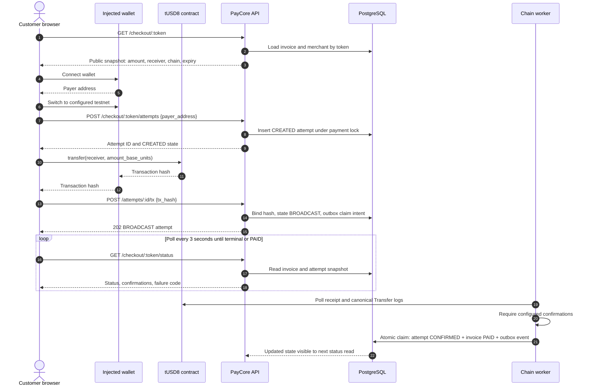
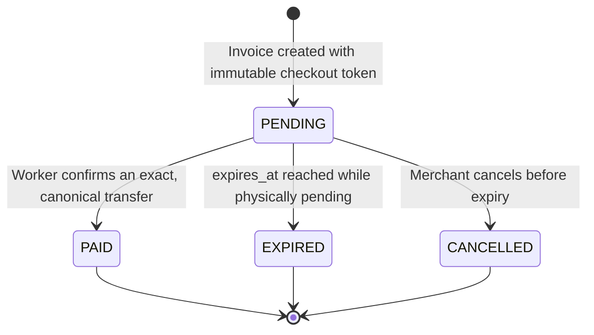
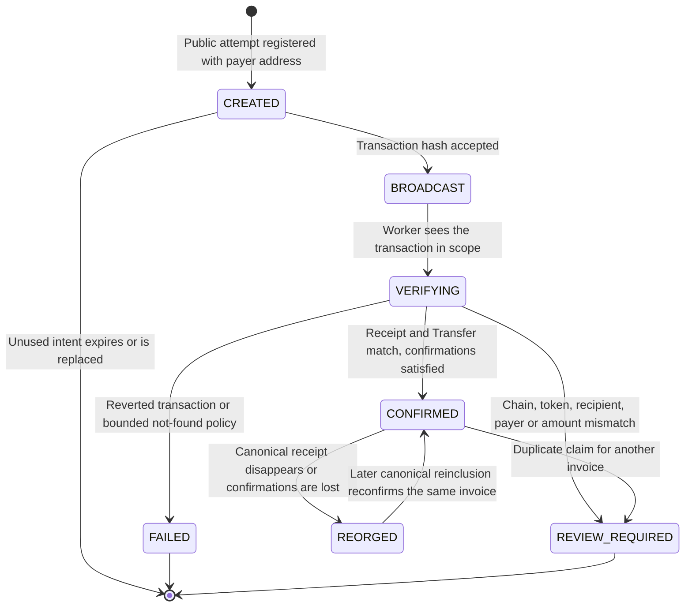

# Quantum payments architecture

PayCore Quantum P0 is a **testnet-only, noncustodial** ERC-20 checkout flow. The API is the source of truth for invoice status; the browser never decides that a payment succeeded. This feature is separate from the accounting ledger and has no webhooks, mandates or automatic refunds in P0. See [API.md](API.md) for the exact contract and [SECURITY.md](SECURITY.md) for the threat model.

## System boundary

```mermaid
flowchart LR
  subgraph MerchantSide[Operator browser]
    Console["Authenticated console<br/>/quantum"]
  end

  subgraph CustomerSide[Customer browser]
    Checkout["Public checkout<br/>/pay/:token"]
    Wallet["Injected wallet"]
  end

  subgraph Chain[QDay testnet]
    Token["tUSD8 ERC-20"]
  end

  subgraph PayCore[PayCore server]
    API["Go API<br/>/api/v1/quantum"]
    Worker["Chain verification worker"]
    DB[("PostgreSQL<br/>invoice + attempt + outbox")]
  end

  Explorer["Testnet explorer"]

  Console -->|Bearer token + quantum permissions| API
  Checkout -->|Public checkout token| API
  Checkout -->|Connect, switch chain, sign/send| Wallet
  Wallet -->|transfer(receiver, amount)| Token
  Wallet -->|Transaction hash| Checkout
  Checkout -->|Submit attempt + tx hash| API
  API --> DB
  Worker -->|Receipt, logs, confirmations| Token
  Worker --> DB
  API -->|Snapshot for polling| Checkout
  Explorer -->|Human verification link| Checkout
  Explorer -->|Human verification link| Console
```

The **trust boundary** is the API request handler. Everything inside `PayCore` is trusted application code; the merchant browser, customer browser, wallet, public chain and explorer are untrusted inputs.

| Boundary crossing | What PayCore trusts | What PayCore verifies |
| --- | --- | --- |
| Merchant console → API | Authenticated actor and RBAC grants | Session token, `quantum:read` / `quantum:write`, per-owner merchant ownership |
| Public checkout → API | Only the opaque checkout token and declared payer address | Token exists, invoice is payable, timestamps and the contract allowlist |
| Wallet → checkout | An injected provider can return a transaction hash | Nothing about success; the hash is only an untrusted reference |
| Chain worker → database | Canonical receipts and Transfer logs from the configured RPC | Chain ID, token emitter, recipient, payer, exact base-unit amount, confirmations and unique claim |
| API → customer | Explicit `PAID` state read from the database | The UI shows success only after this state, never from a wallet hash |

Private keys never reach PayCore. The receiver address comes from `GET /checkout/:token`, not from client-side configuration. The frontend builds chain metadata from `GET /config`; no RPC URL, chain ID or token address is compiled into the browser bundle.

## Payment sequence



Hash submission returns `202` only. It does not query the receipt and does not mark the invoice paid. The customer can close the page after broadcasting; the worker verifies the chain independently. While verification is pending, the checkout shows a confirmations counter from `/status`.

Failure cases stay visible as attempt state plus a failure code: `wrong_chain`, `wrong_token`, `wrong_recipient`, `wrong_payer`, `underpaid`, `overpaid`, `late_payment`, `tx_failed`, `tx_not_found` and `duplicate_transfer`. A failed attempt does not automatically credit or refund an invoice; `REVIEW_REQUIRED` tells the customer to contact the merchant.

## Invoice state machine



Expiry is computed in reads. A transaction mined after its intent was registered can still become `PAID` after its confirmation threshold; an unregistered, late or mismatched transfer goes to review instead. Cancellation cannot reverse an already broadcast transaction.

## Attempt state machine



An unused `CREATED` intent has a 15-minute lifetime; registering another attempt replaces it. Broadcast intents continue through verification and are not removed by that expiry. Recently confirmed attempts are rechecked for 24 hours, which is a demo reorg policy rather than a finality guarantee.

## Frontend layering

| Path | Responsibility |
| --- | --- |
| `web/src/app/quantum/page.tsx` | Protected route; renders the console component only |
| `web/src/app/pay/[token]/page.tsx` | Public route outside the app shell; waits for `params`, wraps client checkout in `Suspense` |
| `web/src/components/quantum/` | Merchant setup, invoice form/list/detail, shared banners and styles |
| `web/src/components/quantum/wallet/` | Client-only wagmi provider and checkout state machine |
| `web/src/lib/quantum-api.ts` | A3 DTO mirrors and one typed function per endpoint; no JSX |
| `web/src/lib/quantum-amount.ts` | String-based decimal parsing and base-unit formatting; no float math |
| `web/src/lib/quantum-labels.ts` | Exhaustive status and failure-code labels |

The console uses the existing authenticated `useApi`, RBAC and pagination primitives. Public `/pay/*` deliberately does not use `useApi`, because that helper requires a session token. The wagmi provider is mounted only in the public checkout subtree and uses `ssr: true` with the runtime chain from `/config`.

## Tests and operations

- `npm test` covers decimal/base-unit boundaries, int64 overflow, exhaustive status and failure labels, explorer URL construction and Quantum RBAC grants.
- `npm run check` runs TypeScript and type-aware ESLint, including exhaustive switch and React Compiler rules.
- Backend checks and worker configuration are documented in [API.md](API.md) and [SECURITY.md](SECURITY.md).
- For the click-through script, see [DEMO.md](DEMO.md). For the future agent-spending design, see [AGENT_MANDATE.md](AGENT_MANDATE.md).
